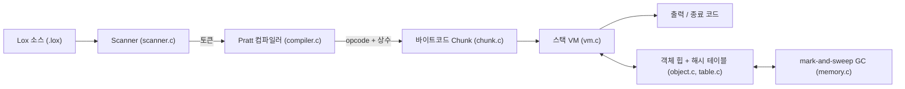
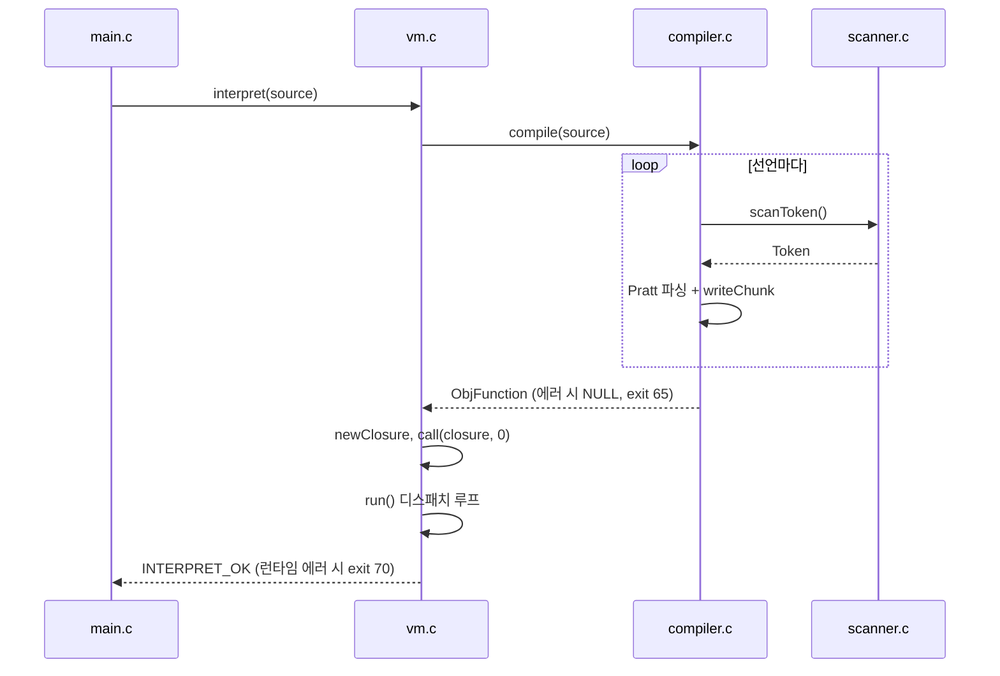

# bytecode-vm (clox)

Lox라는 작은 스크립트 언어를 C로 실행하는 바이트코드 가상 머신(VM)입니다. 교재 Crafting Interpreters 후반부(Part III, Ch 14~29)의 clox를 따라 밑바닥부터 구현했습니다.

## 왜 만들었나

- 프로그래밍 언어가 "소스 코드 → 실행"까지 어떻게 가는지 직접 구현해 보기 위한 학습 프로젝트입니다.
- 렉서, 파서, 컴파일러, 스택 VM, 가비지 컬렉터(GC, 안 쓰는 메모리를 자동 회수하는 장치)를 외부 라이브러리 없이 C 표준 라이브러리만으로 만듭니다.
- 완료 기준은 책의 공식 Lox 테스트 스위트 전체 통과입니다.

## 주요 기능

- 스캐너: 소스를 토큰(키워드, 식별자, 숫자, 문자열, 연산자) 단위로 자름
- Pratt 파서 기반 단일 패스 컴파일러: 연산자 우선순위를 처리하며 소스를 한 번만 읽고 바로 바이트코드 생성
- 스택 기반 VM: 디스패치 루프, 콜 프레임(최대 64개), 런타임 에러 시 스택 트레이스
- 값과 객체: nil/bool/number, 힙 문자열(인터닝), 오픈 어드레싱 해시 테이블
- 전역/지역 변수, if/else, and/or, while, for
- 함수, 재귀, 네이티브 함수 `clock()`
- 클로저: upvalue로 바깥 변수를 값이 아닌 변수 자체로 캡처
- mark-and-sweep GC: 할당량 기반 트리거 (`GC_HEAP_GROW_FACTOR` 2)
- 클래스, 인스턴스 필드, 메서드, `this`, `init` 생성자, 단일 상속, `super`
- 파일 실행 모드 + REPL

## 동작 방식



1. Scanner가 소스 문자열을 필요할 때마다 토큰으로 잘라 넘깁니다.
2. 컴파일러가 토큰을 Pratt 파싱(연산자 우선순위에 따라 표현식을 묶는 방식)으로 해석하면서 즉시 바이트코드를 씁니다. 별도 AST(구문 트리)는 만들지 않습니다.
3. Chunk는 opcode 배열, 상수 배열, 라인 번호를 담은 동적 배열입니다. 함수마다 하나씩 생깁니다.
4. VM이 Chunk의 명령을 하나씩 꺼내 값 스택 위에서 실행합니다.
5. 문자열, 함수, 클로저, 클래스 같은 객체는 힙에 할당되고, GC가 도달할 수 없는 객체를 회수합니다.

스크립트 하나가 실행되는 핵심 흐름은 다음과 같습니다.



종료 코드는 책과 같습니다: 정상 0, 사용법 오류 64, 컴파일 에러 65, 런타임 에러 70, 파일 읽기 실패 74.

## 테스트 결과

| 항목 | 결과 |
|---|---|
| 하네스 | 공식 craftinginterpreters Dart 테스트 러너 (clox suite) |
| 통과 | 246/246 |
| expectations | 568 |
| 검증일 | 2026-07-16 |

clox suite 정의가 jlox 전용 테스트(benchmark, expressions, scanning 등)를 자동으로 제외합니다.

## 빠른 시작

요구 사항: C99 컴파일러(clang 기본), make. 외부 의존성 없음.

```bash
make                  # ./clox 생성
./clox                # REPL
./clox path/to/file.lox
make clean
```

예시 (상속과 메서드 오버라이드):

```lox
class Foo {
  methodOnFoo() { print "foo"; }
  override() { print "foo"; }
}

class Bar < Foo {
  methodOnBar() { print "bar"; }
  override() { print "bar"; }
}

var bar = Bar();
bar.methodOnFoo(); // foo
bar.methodOnBar(); // bar
bar.override();    // bar
```

### 디버그 빌드

`src/common.h`에 정의된 플래그를 `CFLAGS_EXTRA`로 켤 수 있습니다.

| 플래그 | 동작 |
|---|---|
| `DEBUG_TRACE_EXECUTION` | 명령마다 스택 상태 + 디스어셈블 출력 |
| `DEBUG_PRINT_CODE` | 컴파일 직후 각 함수의 바이트코드 출력 |
| `DEBUG_STRESS_GC` | 할당할 때마다 GC 실행 |
| `DEBUG_LOG_GC` | 할당/해제/mark/sweep 로그 출력 |

```bash
make clean && make CFLAGS_EXTRA=-DDEBUG_TRACE_EXECUTION
make clean && make CFLAGS_EXTRA='-DDEBUG_STRESS_GC -DDEBUG_LOG_GC'
```

## 테스트 재현

`test/`는 공식 저장소 스위트의 로컬 사본이며 gitignore 대상입니다. 공식 하네스는 Dart 2 전용이라 Dart 3에서는 실행되지 않습니다.

```bash
# 1. 공식 저장소 + Dart 2.19.6 SDK (arm64 리눅스 기준)
curl -sL -o ci.tar.gz https://github.com/munificent/craftinginterpreters/archive/refs/heads/master.tar.gz
curl -sL -o dartsdk.zip https://storage.googleapis.com/dart-archive/channels/stable/release/2.19.6/sdk/dartsdk-linux-arm64-release.zip
tar xzf ci.tar.gz && unzip -q dartsdk.zip

# 2. clox 빌드 (clang 없으면 CC=gcc)
make CC=gcc

# 3. 하네스 실행
cd craftinginterpreters-master
../dart-sdk/bin/dart pub get --directory tool
../dart-sdk/bin/dart tool/bin/test.dart clox --interpreter <clox 경로>
# => All 246 tests passed (568 expectations).
```

## 프로젝트 구조

```
bytecode-vm/
├── Makefile
├── src/
│   ├── main.c        # 진입점: REPL / 파일 실행
│   ├── scanner.c     # 토큰화
│   ├── compiler.c    # Pratt 파서 + 바이트코드 생성
│   ├── chunk.c       # 바이트코드 Chunk
│   ├── debug.c       # 디스어셈블러
│   ├── vm.c          # 스택 VM, 콜 프레임, 네이티브 함수
│   ├── value.c       # 값 표현
│   ├── object.c      # 문자열, 함수, 클로저, 클래스 등 힙 객체
│   ├── table.c       # 해시 테이블
│   └── memory.c      # 할당 + mark-and-sweep GC
└── .planning/        # 명세와 단계별 plan
```

## 범위 외

- jlox (책 전반부의 Java 트리워크 인터프리터)
- Ch 30 최적화 (NaN boxing 등)
- 확장 후보: JVM 클래스파일 파서 + 미니 JVM 인터프리터, aver/achuk 방향의 AI 코드 신뢰 언어

## 문서

- [docs/SRS.md](docs/SRS.md) - 요구사항 명세
- [docs/SDS.md](docs/SDS.md) - 설계 명세: 구성도, 시퀀스, 자료구조, 모듈
- [docs/adr/](docs/adr/README.md) - 설계 결정 기록
- [CHANGELOG.md](CHANGELOG.md) - 변경 이력
- [명세 (SPEC)](.planning/SPEC.md) - 요구사항 R1~R14, 범위, 엣지 처리 기록
- [plans](.planning/plans/) - 챕터별 구현 plan 8개 (01-chunk-vm-skeleton ~ 08-classes-inheritance-final)
