# bytecode-vm (clox) 소프트웨어 설계 명세서 (SDS)

| 문서 | 버전 | 작성일 | 기준 표준 |
|---|---|---|---|
| bytecode-vm 소프트웨어 설계 명세서 | 1.0 | 2026-11-18 | IEEE 1016-2009 |

## 1. 소개

### 1.1 목적

이 문서는 clox의 내부 설계를 설명합니다. 구성 요소, 자료구조, 바이트코드 형식, 주요 흐름, 알고리즘이 [SRS](SRS.md)의 요구사항을 어떻게 구현하는지 보여줍니다.

### 1.2 범위

`src/`의 C 소스 전체(약 3,000줄, `.c` 파일 10개)와 `Makefile`을 다룹니다. 공식 테스트 러너는 외부 도구이므로 연동 방식만 다룹니다.

### 1.3 용어 정의

용어는 [SRS 1.4 용어 정의](SRS.md#14-용어-정의)를 따릅니다.

### 1.4 참고 문서

| 문서 | 위치 |
|---|---|
| 요구사항 명세 (SRS) | [docs/SRS.md](SRS.md) |
| README | [README.md](../README.md) |
| 원본 명세 (SPEC) | [.planning/SPEC.md](../.planning/SPEC.md) |
| 교재 | Robert Nystrom, *Crafting Interpreters*, Part III (Ch 14~29) |

## 2. 설계 이해관계자와 관심사

| 이해관계자 | 관심사 | 다루는 뷰 |
|---|---|---|
| 언어 구현 학습자 | 소스가 바이트코드가 되어 실행되는 경로, 클로저와 GC의 동작 원리 | 3.2 구성, 3.6 상호작용, 3.8 알고리즘 |
| 유지보수 개발자 | 모듈 책임, 자료구조, 새 객체 타입이나 opcode를 추가할 때 고칠 곳 | 3.3 논리, 3.4 정보, 4 설계 근거 |
| 테스트 러너 운영자 | 실행 방법, 출력 형식, 종료 코드 | 3.1 컨텍스트, 3.5 인터페이스 |
| Lox 스크립트 작성자 | 에러 메시지의 뜻, 언어 한도 | 3.5 인터페이스, 3.9 자원, 5 오류 처리 |

## 3. 설계 뷰

### 3.1 컨텍스트 뷰

clox는 단일 프로세스 CLI입니다. 바깥과는 파일, 표준 입출력, 종료 코드로만 연결됩니다.

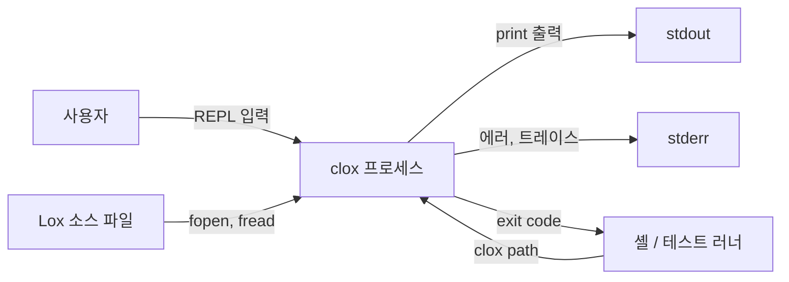

### 3.2 구성 뷰

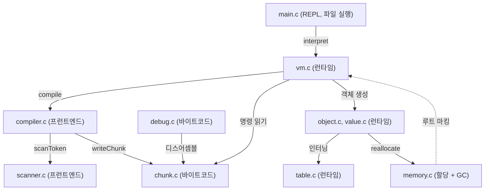

| 구성 요소 | 역할 | 기술 |
|---|---|---|
| `main.c` | 인자 해석, REPL 루프, 파일 읽기, 종료 코드 결정 | C99, `stdio` |
| `scanner.c` | 소스 문자열을 요청 시 토큰 하나씩 잘라 반환 | 손으로 쓴 스캐너, 키워드 trie 분기 |
| `compiler.c` | Pratt 파싱과 바이트코드 생성을 한 번에 수행, 변수 해석 | 단일 패스 컴파일러 |
| `chunk.c` | 바이트코드, 라인 번호, 상수 풀 동적 배열 | 동적 배열 (용량 8부터 2배씩) |
| `debug.c` | 청크 디스어셈블 출력 | `DEBUG_PRINT_CODE`, `DEBUG_TRACE_EXECUTION`에서 사용 |
| `vm.c` | 디스패치 루프, 값 스택, 콜 프레임, upvalue 관리, 런타임 에러 | `switch` 디스패치 |
| `object.c`, `value.c` | 값 표현, 힙 객체 생성, 문자열 인터닝, 출력 | 태그드 유니언, FNV-1a 해시 |
| `table.c` | 문자열 키 해시 테이블 (전역, 인터닝, 메서드, 필드) | 오픈 어드레싱, 선형 탐사, 툼스톤 |
| `memory.c` | 모든 할당의 단일 관문, mark-and-sweep GC | 트라이컬러 마킹, gray 스택 |

### 3.3 논리 뷰

모든 힙 객체는 첫 필드로 `Obj` 헤더를 가집니다. 그래서 `Obj*`로 다루다가 `type`을 보고 구체 타입으로 캐스팅할 수 있습니다.

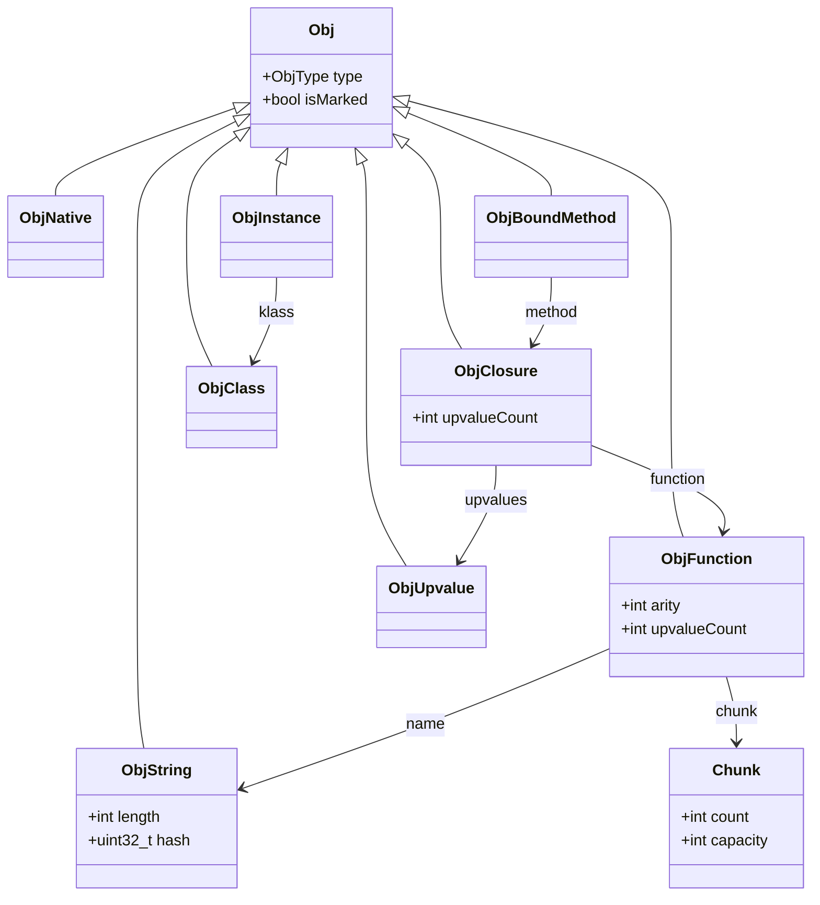

런타임 쪽 구조는 다음과 같습니다.

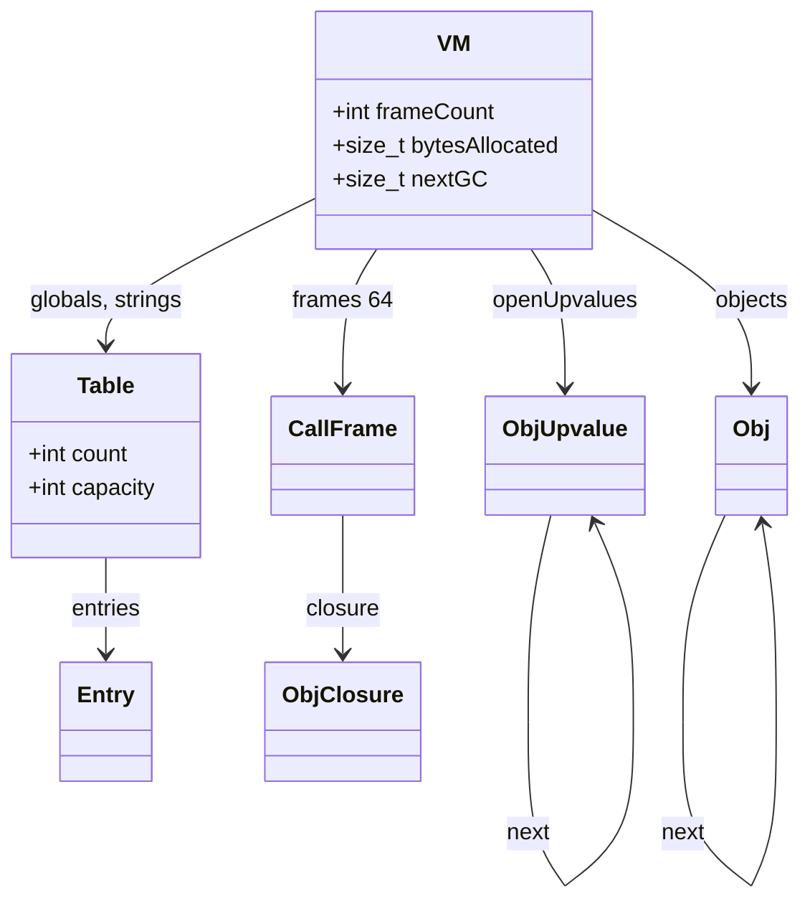

| 관계 | 의미 |
|---|---|
| `Obj.next` | 할당된 모든 객체의 단일 연결 리스트 (`vm.objects`). sweep 대상 목록 |
| `ObjUpvalue.next` | 아직 open인 upvalue의 리스트 (`vm.openUpvalues`). 스택 주소 내림차순 정렬 |
| `ObjClass.methods`, `ObjInstance.fields` | 각각 `Table`. 키는 인터닝된 `ObjString*` |
| `CallFrame.closure` | 실행 중인 함수. 함수는 항상 클로저로 감싸서 호출 |

### 3.4 정보 뷰

clox는 파일을 쓰지 않습니다. 정보 뷰는 메모리 안의 자료구조와 바이트코드 인코딩입니다.

#### 3.4.1 값 표현 (`value.h`)

| 구조체 | 필드 | 설명 |
|---|---|---|
| `Value` | `ValueType type` | `VAL_BOOL`, `VAL_NIL`, `VAL_NUMBER`, `VAL_OBJ` |
| | `union as { bool boolean; double number; Obj* obj; }` | 타입에 맞는 페이로드 하나 |
| `ValueArray` | `int capacity`, `int count`, `Value* values` | 상수 풀용 동적 배열 |

매크로: `IS_*`(타입 검사), `AS_*`(페이로드 꺼내기), `*_VAL`(값 만들기). 동등 비교 `valuesEqual`은 타입이 다르면 false, 객체는 포인터 비교입니다. 문자열은 인터닝되므로 포인터 비교가 곧 내용 비교입니다. 숫자 출력은 `printf("%g")`입니다.

#### 3.4.2 객체 (`object.h`)

| 구조체 | 필드 | 설명 |
|---|---|---|
| `Obj` | `ObjType type`, `bool isMarked`, `struct Obj* next` | 공통 헤더. GC 표시 비트와 전체 객체 리스트 링크 |
| `ObjString` | `int length`, `char* chars`, `uint32_t hash` | NUL 종료 문자열. 해시는 생성 시 FNV-1a로 한 번 계산 |
| `ObjFunction` | `int arity`, `int upvalueCount`, `Chunk chunk`, `ObjString* name` | 컴파일 결과. 최상위 스크립트는 `name == NULL` |
| `ObjNative` | `NativeFn function` | `Value (*)(int argCount, Value* args)` |
| `ObjUpvalue` | `Value* location`, `Value closed`, `struct ObjUpvalue* next` | open이면 `location`이 스택 슬롯, closed면 `&closed` |
| `ObjClosure` | `ObjFunction* function`, `ObjUpvalue** upvalues`, `int upvalueCount` | 함수 + 캡처한 upvalue 배열 |
| `ObjClass` | `ObjString* name`, `Table methods` | 메서드 이름 → `ObjClosure` |
| `ObjInstance` | `ObjClass* klass`, `Table fields` | 필드 이름 → 값 |
| `ObjBoundMethod` | `Value receiver`, `ObjClosure* method` | 호출 시 `receiver`가 슬롯 0(`this`)에 들어감 |

#### 3.4.3 청크와 바이트코드 (`chunk.h`)

| 구조체 | 필드 | 설명 |
|---|---|---|
| `Chunk` | `int count`, `int capacity` | 바이트 수와 할당 용량 |
| | `uint8_t* code` | 바이트코드 |
| | `int* lines` | `code`와 같은 길이. 바이트마다 소스 라인 번호 |
| | `ValueArray constants` | 상수 풀. 명령은 1바이트 인덱스로 참조 (청크당 최대 256개) |

명령 인코딩:

| 피연산자 형식 | 바이트 배치 | 쓰는 opcode |
|---|---|---|
| 없음 | `[op]` | 산술, 비교, `OP_NIL`, `OP_POP`, `OP_PRINT`, `OP_RETURN` 등 |
| 상수 인덱스 | `[op][const]` | `OP_CONSTANT`, 전역/프로퍼티/`super`, `OP_CLASS`, `OP_METHOD` |
| 바이트 | `[op][byte]` | 지역 슬롯, upvalue 인덱스, `OP_CALL`의 인자 수 |
| 점프 | `[op][hi][lo]` | 16비트 big-endian 오프셋. `OP_JUMP`, `OP_JUMP_IF_FALSE`는 앞으로, `OP_LOOP`는 뒤로 |
| 호출 | `[op][const][argc]` | `OP_INVOKE`, `OP_SUPER_INVOKE` |
| 클로저 | `[op][const]` + upvalue마다 `[isLocal][index]` | `OP_CLOSURE` (가변 길이) |

#### 3.4.4 opcode 표

스택 표기는 실행 전 → 실행 후, 오른쪽이 스택 top입니다.

| opcode | 피연산자 | 스택 효과 | 동작 |
|---|---|---|---|
| `OP_CONSTANT` | const | → value | 상수 push |
| `OP_NIL`, `OP_TRUE`, `OP_FALSE` | - | → value | 리터럴 push |
| `OP_POP` | - | a → | 버림 |
| `OP_GET_LOCAL` | slot | → value | `frame->slots[slot]` push |
| `OP_SET_LOCAL` | slot | v → v | 슬롯에 대입. 값은 스택에 남음 (대입은 표현식) |
| `OP_GET_GLOBAL` | const | → value | `vm.globals` 조회. 없으면 런타임 에러 |
| `OP_DEFINE_GLOBAL` | const | v → | 전역 정의 (재정의 허용) |
| `OP_SET_GLOBAL` | const | v → v | 기존 전역에만 대입. 새 키면 지우고 런타임 에러 |
| `OP_GET_UPVALUE` | index | → value | `*upvalues[index]->location` push |
| `OP_SET_UPVALUE` | index | v → v | upvalue가 가리키는 곳에 대입 |
| `OP_GET_PROPERTY` | const | inst → value | 필드 우선, 없으면 메서드를 바운드 메서드로 |
| `OP_SET_PROPERTY` | const | inst v → v | 필드 설정 |
| `OP_GET_SUPER` | const | this super → bound | 슈퍼클래스 메서드를 `this`에 바인딩 |
| `OP_EQUAL` | - | a b → bool | `valuesEqual` |
| `OP_GREATER`, `OP_LESS` | - | a b → bool | 숫자만 |
| `OP_ADD` | - | a b → c | 숫자 덧셈 또는 문자열 연결 |
| `OP_SUBTRACT`, `OP_MULTIPLY`, `OP_DIVIDE` | - | a b → c | 숫자만 |
| `OP_NOT` | - | a → bool | nil과 false만 거짓 |
| `OP_NEGATE` | - | a → -a | 숫자만 |
| `OP_PRINT` | - | a → | 값 출력 + 줄바꿈 |
| `OP_JUMP` | offset16 | - | `ip += offset` |
| `OP_JUMP_IF_FALSE` | offset16 | cond → cond | 거짓이면 점프. 조건 값은 남김 (뒤에 `OP_POP`) |
| `OP_LOOP` | offset16 | - | `ip -= offset` |
| `OP_CALL` | argc | callee args → result | 클로저, 네이티브, 클래스, 바운드 메서드 호출 |
| `OP_INVOKE` | const, argc | recv args → result | 프로퍼티 조회 + 호출 융합 |
| `OP_SUPER_INVOKE` | const, argc | this args super → result | 슈퍼클래스 메서드 직접 호출 |
| `OP_CLOSURE` | const, (isLocal, index)* | → closure | 클로저 생성, upvalue 캡처 |
| `OP_CLOSE_UPVALUE` | - | v → | top 슬롯의 upvalue를 close 후 pop |
| `OP_RETURN` | - | frame → result | upvalue close, 프레임 제거, 결과 push |
| `OP_CLASS` | const | → class | 빈 클래스 생성 |
| `OP_INHERIT` | - | super sub → super | 슈퍼클래스 메서드를 서브클래스로 복사 |
| `OP_METHOD` | const | class closure → class | 메서드 등록 |

컴파일러가 합성하는 연산: `!=` = `OP_EQUAL OP_NOT`, `>=` = `OP_LESS OP_NOT`, `<=` = `OP_GREATER OP_NOT`.

#### 3.4.5 해시 테이블 (`table.h`)

| 구조체 | 필드 | 설명 |
|---|---|---|
| `Entry` | `ObjString* key`, `Value value` | 키는 인터닝된 문자열이라 포인터로 비교 |
| `Table` | `int count`, `int capacity`, `Entry* entries` | `count`는 툼스톤 포함. 용량은 2의 거듭제곱 |

| 슬롯 상태 | 인코딩 |
|---|---|
| 빈 슬롯 | `key == NULL`, `value == nil` |
| 툼스톤 | `key == NULL`, `value == true` |
| 사용 중 | `key != NULL` |

#### 3.4.6 VM과 콜 프레임 (`vm.h`)

| 구조체 | 필드 | 설명 |
|---|---|---|
| `CallFrame` | `ObjClosure* closure` | 실행 중인 클로저 |
| | `uint8_t* ip` | 이 프레임의 다음 명령 위치 |
| | `Value* slots` | 값 스택에서 이 프레임이 시작하는 곳. 슬롯 0은 호출 대상(메서드면 `this`) |
| `VM` | `CallFrame frames[FRAMES_MAX]`, `int frameCount` | 콜 프레임 스택 (최대 64) |
| | `Value stack[STACK_MAX]`, `Value* stackTop` | 값 스택 (`FRAMES_MAX * 256` = 16384칸) |
| | `Table globals` | 전역 변수 |
| | `Table strings` | 인터닝 테이블 (GC 약한 참조) |
| | `ObjString* initString` | `"init"` 캐시. 생성자 조회용 |
| | `ObjUpvalue* openUpvalues` | open upvalue 정렬 리스트 |
| | `size_t bytesAllocated`, `size_t nextGC` | GC 회계와 다음 실행 임계값 |
| | `Obj* objects` | 전체 객체 리스트 |
| | `int grayCount`, `int grayCapacity`, `Obj** grayStack` | GC 작업 목록 (GC 관리 밖 `realloc`) |

#### 3.4.7 컴파일러 상태 (`compiler.c`, `scanner.c`)

| 구조체 | 필드 | 설명 |
|---|---|---|
| `Scanner` | `start`, `current`, `line` | 현재 토큰 시작, 읽는 위치, 라인 |
| `Token` | `TokenType type`, `const char* start`, `int length`, `int line` | 소스를 가리키는 슬라이스 (복사 없음) |
| `Parser` | `Token current`, `Token previous`, `bool hadError`, `bool panicMode` | 1토큰 lookahead와 에러 상태 |
| `ParseRule` | `ParseFn prefix`, `ParseFn infix`, `Precedence precedence` | 토큰 타입별 Pratt 규칙 (`rules[]`) |
| `Local` | `Token name`, `int depth`, `bool isCaptured` | `depth == -1`은 선언됐지만 아직 초기화 전 |
| `Upvalue` | `uint8_t index`, `bool isLocal` | 바깥 함수의 지역 슬롯인지, 바깥 함수의 upvalue인지 |
| `Compiler` | `enclosing`, `function`, `type`, `locals[256]`, `localCount`, `upvalues[256]`, `scopeDepth` | 함수마다 하나. `enclosing`으로 중첩 |
| `ClassCompiler` | `enclosing`, `hasSuperclass` | `this`, `super` 사용 가능 여부 판정 |

`FunctionType`: `TYPE_FUNCTION`, `TYPE_INITIALIZER`, `TYPE_METHOD`, `TYPE_SCRIPT`. 함수가 아닌 타입은 슬롯 0 이름을 `this`로 예약합니다.

#### 3.4.8 디스어셈블 출력 형식 (`debug.c`)

```
== <함수 이름 또는 <script>> ==
<오프셋 4자리> <라인 4자리 또는 "   |"> <opcode> <피연산자>
```

| 형식 | 예시 패턴 |
|---|---|
| 상수 | `OP_CONSTANT      <idx> '<값>'` |
| 바이트 | `OP_GET_LOCAL     <slot>` |
| 점프 | `OP_JUMP          <오프셋> -> <목표>` |
| 호출 | `OP_INVOKE        (<n> args) <idx> '<이름>'` |
| 클로저 | 다음 줄마다 `local <index>` 또는 `upvalue <index>` |

### 3.5 인터페이스 뷰

#### CLI

| 사용법 | 동작 | 종료 코드 |
|---|---|---|
| `./clox` | REPL. `> ` 프롬프트, 한 줄(최대 1024바이트)씩 `interpret`. EOF에서 종료 | 0 |
| `./clox <path>` | 파일 전체를 읽어 실행 | 0 / 65 / 70 / 74 |
| `./clox a b` | `Usage: clox [path]` 출력 | 64 |

| 종료 코드 | 조건 |
|---|---|
| 0 | 정상 종료 |
| 64 | 인자 개수 오류 |
| 65 | 컴파일 에러 (`INTERPRET_COMPILE_ERROR`) |
| 70 | 런타임 에러 (`INTERPRET_RUNTIME_ERROR`) |
| 74 | 파일 열기 실패, 메모리 부족, 읽기 실패 |

#### 진단 출력 (stderr)

| 종류 | 형식 |
|---|---|
| 컴파일 에러 | `[line N] Error at '<토큰>': <메시지>` / 파일 끝이면 `[line N] Error at end: <메시지>` / 스캐너 에러면 `[line N] Error: <메시지>` |
| 런타임 에러 | `<메시지>` 다음, 안쪽 프레임부터 `[line N] in <함수>()`, 최상위는 `[line N] in script` |

#### 빌드 인터페이스

| 명령 | 결과 |
|---|---|
| `make` | `build/*.o`를 거쳐 `./clox` 생성 (`-std=c99 -Wall -Wextra -Wno-unused-parameter -g -O2`) |
| `make CFLAGS_EXTRA=-DDEBUG_TRACE_EXECUTION` | 명령마다 스택 + 디스어셈블 출력 |
| `make CFLAGS_EXTRA=-DDEBUG_PRINT_CODE` | 컴파일 직후 함수별 바이트코드 출력 (에러 없을 때만) |
| `make CFLAGS_EXTRA='-DDEBUG_STRESS_GC -DDEBUG_LOG_GC'` | 할당마다 GC + 할당/mark/blacken/free 로그 |
| `make clean` | `build/`, `clox` 삭제 |

#### 내장 함수

| 이름 | 반환 | 비고 |
|---|---|---|
| `clock()` | 프로세스 CPU 시간(초), `clock() / CLOCKS_PER_SEC` | 인자 개수를 검사하지 않음 |

### 3.6 상호작용 뷰

#### 3.6.1 스크립트 컴파일과 실행

`interpret`는 소스를 최상위 함수 하나로 컴파일하고, 클로저로 감싸 프레임 0에 올린 뒤 `run()`을 돌립니다. 컴파일 에러가 하나라도 있으면 실행하지 않습니다.

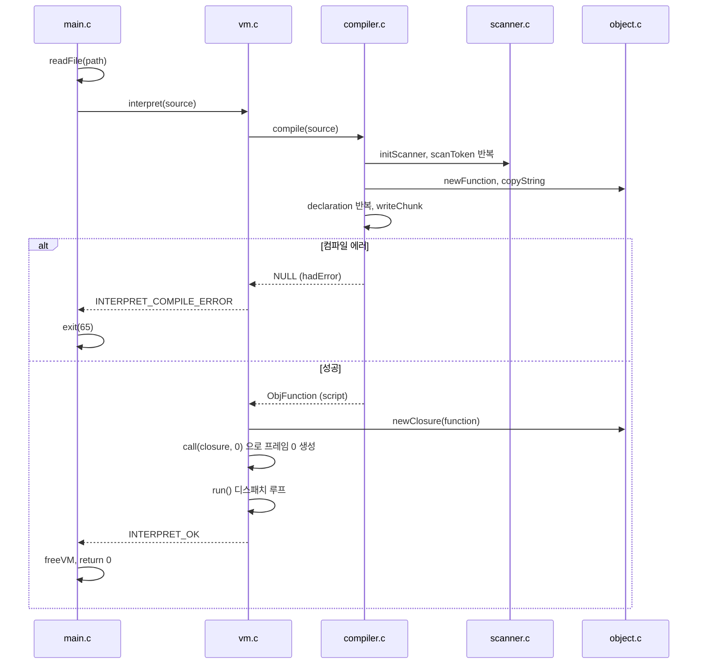

#### 3.6.2 함수 호출과 콜 프레임

`OP_CALL`은 C 재귀 없이 새 `CallFrame`을 쌓고, `run()`은 지역 변수 `frame`만 바꿔 같은 루프를 계속 돕니다. 인자 수가 틀리거나 프레임이 64개면 런타임 에러로 끝납니다.

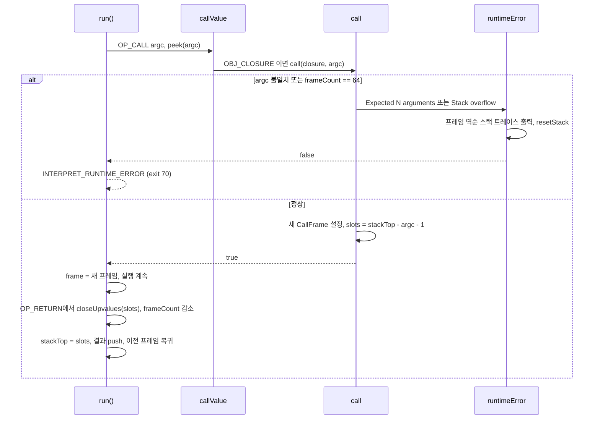

#### 3.6.3 클로저의 upvalue 캡처와 close

컴파일러가 `OP_CLOSURE` 뒤에 (isLocal, index) 쌍을 써 두면, VM이 실행 시 캡처합니다. 같은 슬롯은 `openUpvalues`에서 찾아 재사용하므로 두 클로저가 같은 변수를 공유합니다. 변수가 스택에서 사라질 때 값을 upvalue 안으로 옮깁니다.

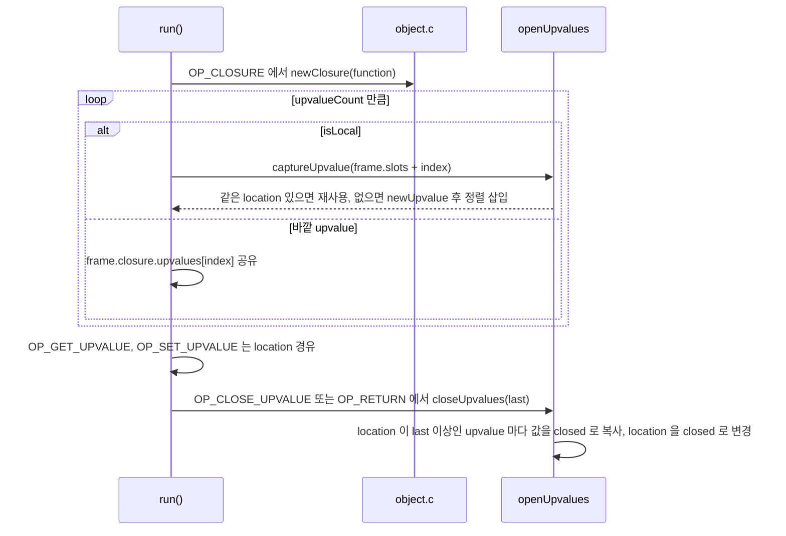

#### 3.6.4 GC 사이클

모든 할당은 `reallocate`를 지납니다. 크기가 늘어나는 할당에서 임계값을 넘으면(또는 `DEBUG_STRESS_GC`면 항상) 한 사이클을 돕니다.

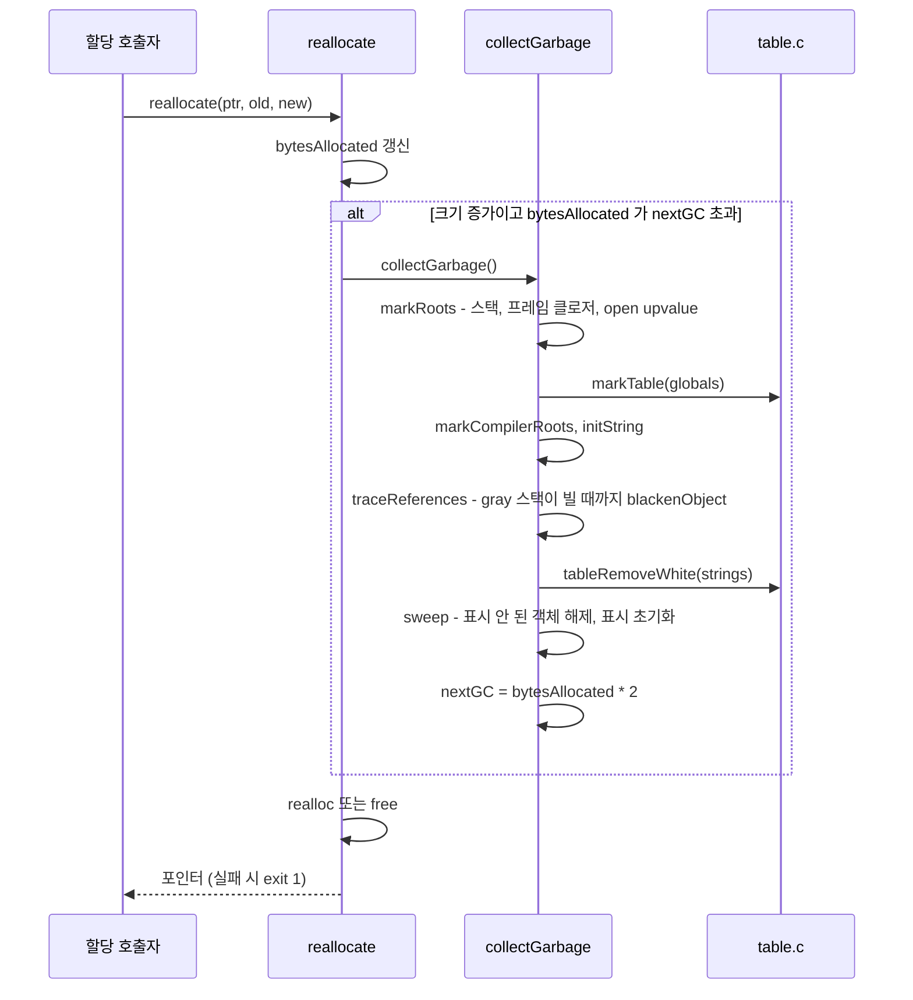

### 3.7 상태 동적 뷰

#### 3.7.1 VM 실행 상태

`interpret` 한 번의 결과는 `InterpretResult` 세 값 중 하나입니다. REPL은 결과와 상관없이 다음 줄로 돌아가고, 파일 모드는 결과에 따라 종료합니다.

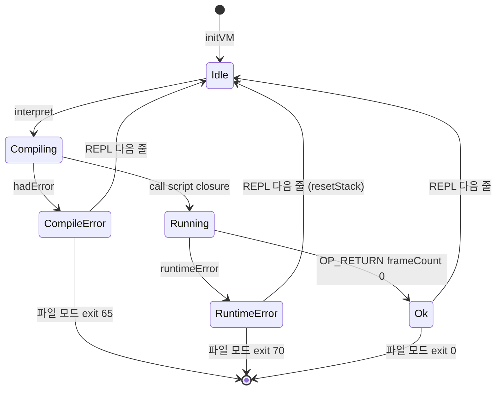

#### 3.7.2 upvalue 생명주기

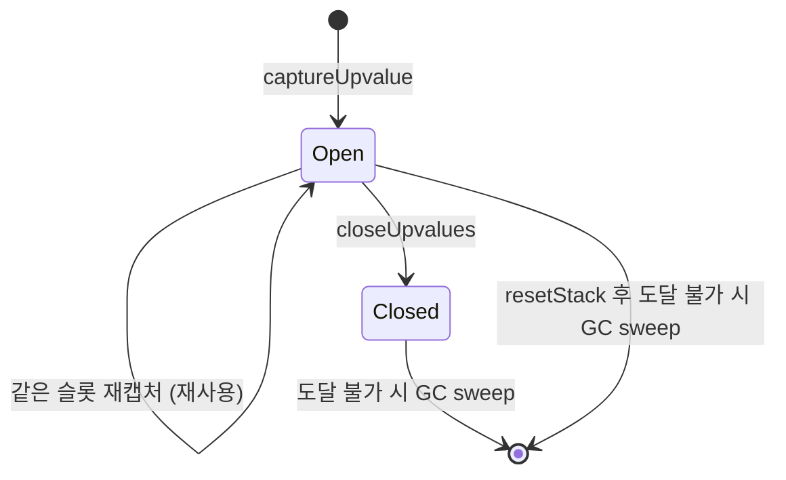

| 상태 | `location` | 위치 |
|---|---|---|
| `Open` | 값 스택 슬롯 주소 | `vm.openUpvalues` 리스트 안 |
| `Closed` | `&upvalue->closed` | 리스트에서 빠짐 |

#### 3.7.3 GC 객체 색

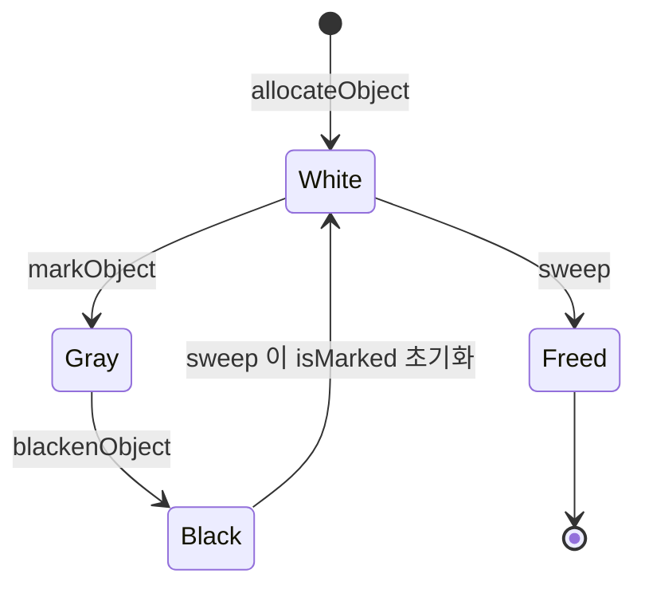

| 색 | 코드 표현 |
|---|---|
| White | `isMarked == false` |
| Gray | `isMarked == true`이고 `vm.grayStack`에 있음 |
| Black | `isMarked == true`이고 gray 스택에서 꺼내 참조 추적 완료 |

### 3.8 알고리즘 뷰

#### 3.8.1 Pratt 파싱 (`parsePrecedence`)

1. 토큰 하나를 읽고 그 타입의 prefix 규칙을 찾는다. 없으면 `Expect expression.`
2. `canAssign = (precedence <= PREC_ASSIGNMENT)`를 prefix 함수에 넘긴다.
3. 다음 토큰의 infix 우선순위가 `precedence` 이상인 동안 토큰을 읽고 infix 함수를 호출한다.
4. 이항 연산자는 오른쪽 피연산자를 `우선순위 + 1`로 파싱해 왼쪽 결합을 만든다.
5. 끝났는데 `=`가 남아 있고 대입 가능 위치였다면 `Invalid assignment target.`

우선순위(낮음 → 높음): `ASSIGNMENT` < `OR` < `AND` < `EQUALITY` < `COMPARISON` < `TERM` < `FACTOR` < `UNARY` < `CALL` < `PRIMARY`.

#### 3.8.2 변수 해석 (`namedVariable`)

1. 현재 함수의 `locals`를 뒤에서부터 찾는다 → `OP_GET_LOCAL`/`OP_SET_LOCAL slot`
2. 없으면 `resolveUpvalue`: 바깥 함수의 지역이면 그 지역의 `isCaptured = true`로 표시하고 (index, isLocal=true) upvalue 추가. 바깥 함수의 upvalue면 재귀 해석 후 (index, isLocal=false) 추가. 같은 (index, isLocal)은 중복 추가하지 않는다 → `OP_GET_UPVALUE`/`OP_SET_UPVALUE`
3. 그래도 없으면 전역: 이름을 상수 풀에 넣고 `OP_GET_GLOBAL`/`OP_SET_GLOBAL`

스코프가 끝나면 `isCaptured`인 지역은 `OP_CLOSE_UPVALUE`, 나머지는 `OP_POP`을 낸다.

#### 3.8.3 점프 백패칭

1. `emitJump`: opcode + 자리표시 `0xff 0xff`를 쓰고 피연산자 위치를 반환
2. 본문 컴파일
3. `patchJump`: `jump = count - offset - 2`. 65535를 넘으면 `Too much code to jump over.` 아니면 big-endian으로 기록
4. 루프는 `emitLoop(loopStart)`가 `offset = count - loopStart + 2`를 바로 기록. 65535를 넘으면 `Loop body too large.`

`and`는 왼쪽이 거짓이면 끝으로 점프, `or`는 왼쪽이 거짓일 때만 오른쪽으로 점프합니다. `for`는 초기화 / 조건 / 증가 / 본문을 점프와 루프로 풀어서 컴파일합니다.

#### 3.8.4 해시 테이블 탐사 (`findEntry`)

1. `index = hash & (capacity - 1)`
2. 빈 슬롯을 만나면: 앞서 본 툼스톤이 있으면 그 툼스톤을, 없으면 빈 슬롯을 반환 (삽입 시 툼스톤 재사용)
3. 툼스톤이면 첫 툼스톤만 기억하고 계속
4. 키 포인터가 같으면 반환
5. `index = (index + 1) & (capacity - 1)`로 선형 탐사

`tableSet`은 `count + 1 > capacity * 0.75`면 용량을 2배(최소 8)로 늘립니다. 재배치(`adjustCapacity`) 때 툼스톤은 버리고 `count`를 다시 셉니다. `tableFindString`은 인터닝 전용으로, 포인터 대신 길이, 해시, `memcmp`로 비교합니다.

#### 3.8.5 문자열 인터닝

1. `copyString`/`takeString`이 FNV-1a 해시(시작 2166136261, 곱 16777619)를 계산
2. `tableFindString(&vm.strings, ...)`로 같은 내용을 찾으면 기존 객체 반환 (`takeString`은 넘겨받은 버퍼를 해제)
3. 없으면 `ObjString`을 만들고 스택에 잠시 push한 상태로 `vm.strings`에 등록 (등록 중 GC로부터 보호)

#### 3.8.6 mark-and-sweep (`collectGarbage`)

1. 루트 표시: 값 스택 전체, 각 프레임의 클로저, open upvalue, `vm.globals`, 컴파일 중인 함수 체인(`markCompilerRoots`), `vm.initString`
2. 추적: gray 스택에서 하나씩 꺼내 `blackenObject`. 타입별로 참조를 표시한다

   | 타입 | 따라가는 참조 |
   |---|---|
   | `ObjBoundMethod` | `receiver`, `method` |
   | `ObjClass` | `name`, `methods` 테이블 |
   | `ObjClosure` | `function`, `upvalues[]` |
   | `ObjFunction` | `name`, 상수 풀 |
   | `ObjInstance` | `klass`, `fields` 테이블 |
   | `ObjUpvalue` | `closed` |
   | `ObjNative`, `ObjString` | 없음 |

3. 약한 참조 정리: `tableRemoveWhite(&vm.strings)`가 표시 안 된 키를 툼스톤으로 바꾼다
4. 해제: `vm.objects`를 순회하며 표시 안 된 객체를 리스트에서 떼고 `freeObject`. 살아남은 객체는 `isMarked = false`로 되돌린다
5. `nextGC = bytesAllocated * GC_HEAP_GROW_FACTOR(2)`

GC 도중 할당되는 신생 객체는 루트에 닿을 때까지 스택에 push해 보호합니다 (`addConstant`, `allocateString`, `defineNative`, `interpret`의 함수 → 클로저 전환, `concatenate`는 피연산자를 `peek`으로 두고 결과 후 pop).

#### 3.8.7 메서드 호출 (`invoke`)

1. 수신 객체가 인스턴스가 아니면 `Only instances have methods.`
2. 같은 이름의 필드가 있으면 그 값을 슬롯에 넣고 `callValue` (필드가 메서드를 가림)
3. 없으면 `klass->methods`에서 클로저를 찾아 바로 `call`. 바운드 메서드 객체를 만들지 않는다

상속(`OP_INHERIT`)은 슈퍼클래스의 `methods`를 서브클래스로 `tableAddAll` 복사합니다. 서브클래스 메서드는 복사 뒤에 정의되므로 오버라이드가 덮어씁니다. `super`는 클래스 선언 시 만든 합성 지역 변수 `"super"`를 upvalue로 캡처해 찾습니다.

### 3.9 자원 뷰

| 자원 | 한도 / 값 | 근거 |
|---|---|---|
| 스레드 | 단일 스레드. 동시성 없음 | 전역 `vm`, `parser`, `scanner` |
| 콜 프레임 | 64 (`FRAMES_MAX`) | `vm.h` |
| 값 스택 | 16384칸 (`FRAMES_MAX * UINT8_COUNT`), 정적 배열 | `vm.h` |
| 함수당 지역 변수 | 256 (슬롯 0 포함) | `Compiler.locals[UINT8_COUNT]` |
| 함수당 upvalue | 256 | `Compiler.upvalues[UINT8_COUNT]` |
| 청크당 상수 | 256 (1바이트 인덱스) | `makeConstant` |
| 인자 / 매개변수 | 255 | `argumentList`, `function` |
| 점프 거리 | 65535바이트 | `patchJump`, `emitLoop` |
| REPL 한 줄 | 1024바이트 버퍼 | `main.c` `repl` |
| GC 첫 임계값 | 1 MiB (`1024 * 1024`) | `initVM` |
| GC 성장 계수 | 2 | `GC_HEAP_GROW_FACTOR` |
| 해시 테이블 | 최대 적재율 0.75, 최소 용량 8 | `TABLE_MAX_LOAD`, `GROW_CAPACITY` |
| 파일 | 소스 파일 하나를 통째로 메모리에 읽음. 쓰는 파일 없음 | `readFile` |
| 메모리 할당 실패 | `exit(1)` | `reallocate`, `markObject` |

## 4. 설계 근거

각 결정의 배경과 결과는 [ADR](adr/README.md)에 기록되어 있습니다.

| 결정 | 대안 | 선택 이유 |
|---|---|---|
| 단일 패스 컴파일 (AST 없음) | AST 생성 후 코드 생성 | 교재 설계. 구문 트리 할당이 없어 단순하고 빠름 |
| 스택 기반 VM | 레지스터 기반 VM | 컴파일러가 피연산자 위치를 관리할 필요가 없어 코드 생성이 단순 |
| 함수 호출 = `run()` 안의 프레임 전환 | C 재귀로 `run()` 재호출 | 호출 비용이 작고, 콜 깊이를 `FRAMES_MAX`로 직접 제어해 C 스택 오버플로 없이 `Stack overflow.` 에러 |
| 지역 변수 컴파일 타임 슬롯 해석 | 런타임 이름 조회 | 지역 접근이 배열 인덱스 하나. 전역만 해시 테이블(늦은 바인딩) |
| upvalue open/closed 2단계 | 클로저 생성 시 값 복사 | Lox 의미론은 변수 캡처. 스택에 있는 동안은 공유, 벗어날 때만 힙으로 이동 |
| `openUpvalues` 주소순 정렬 리스트 | 매번 새 upvalue 생성 | 같은 슬롯의 upvalue가 VM 전체에서 하나 → 공유 대입이 보임. close 시 앞부분만 훑으면 됨 |
| 모든 문자열 인터닝 | 내용 비교 | `==`와 테이블 키 비교가 포인터 비교가 됨 |
| 오픈 어드레싱 + 선형 탐사 + 툼스톤 | 체이닝 | 연속 메모리로 캐시 친화적. 툼스톤으로 삭제 후에도 탐사 체인 유지 |
| 모든 할당이 `reallocate` 통과 | 곳곳에서 `malloc`/`free` | GC가 `bytesAllocated`를 정확히 세고 트리거 지점을 한 곳에 둠 |
| gray 스택은 시스템 `realloc` 직접 사용 | `reallocate` 사용 | GC 도중 gray 스택 확장이 GC를 재귀 트리거하지 않게 함 |
| 인터닝 테이블 약한 참조 | 인터닝 테이블을 루트로 마킹 | 루트로 두면 한 번 만든 문자열이 영원히 회수되지 않음 |
| 할당량 기반 GC 트리거 (×2) | 고정 주기, 객체 수 기준 | 살아 있는 힙 크기에 비례해 GC 빈도가 조절됨 |
| 상속 = 메서드 복사 (`tableAddAll`) | 런타임 슈퍼클래스 체인 탐색 | 메서드 조회가 테이블 한 번. Lox 클래스는 선언 후 바뀌지 않으므로 복사로 충분 |
| `OP_INVOKE` 융합 | `OP_GET_PROPERTY` + `OP_CALL` | 메서드 호출마다 바운드 메서드 객체를 할당하지 않음. `var m = obj.method;`는 여전히 바운드 메서드 |
| `super`를 합성 지역 변수로 캡처 | 클래스 객체에 슈퍼클래스 포인터 | 기존 upvalue 장치를 재사용. 클래스 선언 스코프에 묶여 정확한 슈퍼클래스를 가리킴 |
| 슬롯 0 예약 | 슬롯 0 없이 인자부터 | 메서드와 `init`에서 `this`가 자연스럽게 슬롯 0에 놓임 |
| Value 태그드 유니언 | NaN boxing | NaN boxing은 Ch 30 최적화로 범위 외 |
| 바이트마다 라인 번호 저장 (`int* lines`) | 런 길이 압축 | 구현이 단순. 에러 보고에 필요한 정보는 같음 |
| 상수 인덱스 1바이트 | 긴 상수 opcode 추가 | 교재 본편 설계. 256개 초과는 컴파일 에러로 처리 |

## 5. 오류 처리와 엣지 케이스

| 상황 | 동작 |
|---|---|
| 문법 오류 | `[line N] Error at '...': <메시지>`, `hadError` 설정 후 패닉 모드 |
| 패닉 모드 중 추가 에러 | 출력하지 않음. `synchronize`가 `;` 다음이나 `class`/`fun`/`var`/`for`/`if`/`while`/`print`/`return` 앞까지 건너뜀 |
| 컴파일 에러가 하나라도 있음 | 실행하지 않고 exit 65 |
| 닫히지 않은 문자열 / 알 수 없는 문자 | `Unterminated string.` / `Unexpected character.` (스캐너 에러 토큰) |
| `var a = a;` (지역) | `Can't read local variable in its own initializer.` |
| 같은 스코프에 같은 이름 재선언 (지역) | `Already a variable with this name in this scope.` |
| 대입할 수 없는 대상 (`a + b = c`) | `Invalid assignment target.` |
| 최상위 `return` | `Can't return from top-level code.` |
| `init` 안의 `return 값;` | `Can't return a value from an initializer.` (`return;`은 허용, `this` 반환) |
| 클래스 밖 `this` / `super` | `Can't use 'this' outside of a class.` / `Can't use 'super' outside of a class.` |
| 슈퍼클래스 없는 클래스의 `super` | `Can't use 'super' in a class with no superclass.` |
| `class A < A {}` | `A class can't inherit from itself.` |
| 청크 상수 256개 초과 | `Too many constants in one chunk.` |
| 함수 지역 변수 256개 초과 | `Too many local variables in function.` |
| 함수 upvalue 256개 초과 | `Too many closure variables in function.` |
| 인자 / 매개변수 255개 초과 | `Can't have more than 255 arguments.` / `Can't have more than 255 parameters.` |
| 점프 / 루프 거리 65535 초과 | `Too much code to jump over.` / `Loop body too large.` |
| 숫자가 아닌 피연산자 (단항 `-`) | `Operand must be a number.`, exit 70 |
| 숫자가 아닌 피연산자 (`-`, `*`, `/`, `<`, `>`) | `Operands must be numbers.`, exit 70 |
| `+`의 타입 불일치 | `Operands must be two numbers or two strings.`, exit 70 |
| 정의되지 않은 전역 읽기 / 대입 | `Undefined variable 'x'.` 대입의 경우 잘못 생긴 키를 지운 뒤 에러 |
| 호출할 수 없는 값 호출 | `Can only call functions and classes.` |
| 인자 개수 불일치 (함수, 메서드, `init`) | `Expected N arguments but got M.` |
| `init` 없는 클래스에 인자 전달 | `Expected 0 arguments but got M.` |
| 콜 프레임 64개 초과 | `Stack overflow.` + 스택 트레이스, exit 70 |
| 인스턴스가 아닌 값의 프로퍼티 읽기 / 쓰기 / 메서드 호출 | `Only instances have properties.` / `Only instances have fields.` / `Only instances have methods.` |
| 없는 프로퍼티 / 메서드 | `Undefined property 'x'.` |
| 클래스가 아닌 값 상속 | `Superclass must be a class.` |
| 필드가 같은 이름의 메서드를 가림 | `OP_INVOKE`도 필드를 먼저 확인해 그 값을 호출 |
| 런타임 에러 직후 | `resetStack`으로 값 스택, 프레임, open upvalue 초기화. REPL은 전역을 유지한 채 계속 |
| 네이티브 함수에 인자 전달 (`clock(1)`) | 인자 수를 검사하지 않고 무시 |
| 정수 값 숫자 출력 | `%g`라 `3.0`은 `3`으로 출력 |
| 파일 열기 / 메모리 / 읽기 실패 | `Could not open file "..."` / `Not enough memory to read "..."` / `Could not read file "..."`, exit 74 |
| 인자 2개 이상 | `Usage: clox [path]`, exit 64 |
| 메모리 할당 실패 (`realloc` NULL) | `exit(1)` |

## 6. 요구사항-설계 추적

| 요구사항 ID | 담당 설계 요소 |
|---|---|
| FR-1 | 3.4.3 청크, 3.4.8 디스어셈블 형식 / `chunk.c`, `debug.c`, `memory.c` |
| FR-2 | 3.4.4 opcode 표, 3.4.6 VM / `vm.c` `run()` |
| FR-3 | 3.4.7 Scanner, Token / `scanner.c` |
| FR-4 | 3.8.1 Pratt 파싱 / `compiler.c` `rules[]`, `parsePrecedence` |
| FR-5 | 3.4.1 값 표현 / `value.c`, `vm.c` `runtimeError` |
| FR-6 | 3.4.5 해시 테이블, 3.8.4 탐사, 3.8.5 인터닝 / `table.c`, `object.c` |
| FR-7 | 3.8.2 변수 해석 / `compiler.c` `namedVariable`, `vm.c` 전역 opcode |
| FR-8 | 3.8.3 점프 백패칭 / `compiler.c` `emitJump`, `patchJump`, `emitLoop` |
| FR-9 | 3.6.2 함수 호출, 3.4.6 CallFrame / `vm.c` `call`, `callValue` |
| FR-10 | 3.6.3 upvalue, 3.7.2 upvalue 생명주기 / `compiler.c` `resolveUpvalue`, `vm.c` `captureUpvalue`, `closeUpvalues` |
| FR-11 | 3.6.4 GC 사이클, 3.7.3 객체 색, 3.8.6 mark-and-sweep / `memory.c` |
| FR-12 | 3.4.2 객체, 3.8.7 메서드 호출 / `vm.c` `invoke`, `bindMethod`, `compiler.c` `method` |
| FR-13 | 3.8.7 상속과 `super` / `compiler.c` `classDeclaration`, `super_`, `vm.c` `OP_INHERIT` |
| FR-14 | 전체 설계 / 공식 러너 연동 (3.1 컨텍스트 뷰) |
| FR-15 | 3.5 CLI, 3.7.1 VM 실행 상태 / `main.c` |
| NFR-1 | 3.8.6 mark-and-sweep (임계값 갱신), 3.9 자원 뷰 |
| NFR-2 | 3.9 자원 뷰, 5 오류 처리 |
| NFR-3, NFR-4 | 3.5 진단 출력 / `compiler.c` `errorAt`, `vm.c` `runtimeError` |
| NFR-5 | 3.5 빌드 인터페이스 / `common.h`, `Makefile` |
| NFR-6 | 5 오류 처리 (모든 에러가 종료 코드로 끝남) |
| NFR-7 | 3.8.6 신생 객체 보호 / `DEBUG_STRESS_GC` |
| NFR-8, NFR-9, NFR-10 | 3.5 빌드 인터페이스 / `Makefile` |
