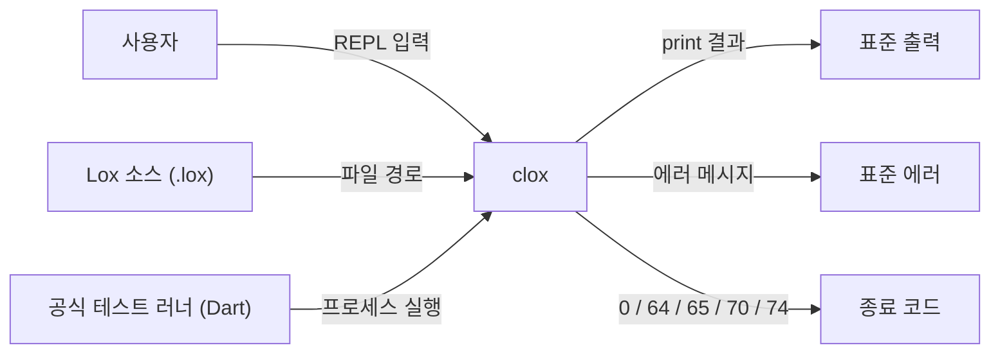

# bytecode-vm (clox) 소프트웨어 요구사항 명세서 (SRS)

| 문서 | 버전 | 작성일 | 기준 표준 |
|---|---|---|---|
| bytecode-vm 소프트웨어 요구사항 명세서 | 1.0 | 2026-11-18 | ISO/IEC/IEEE 29148:2018 |

## 1. 소개

### 1.1 목적

이 문서는 Lox 언어용 바이트코드 VM인 clox가 무엇을 해야 하는지 정의합니다. 각 요구사항의 수용 기준과 검증 근거를 함께 적어, 구현이 요구사항을 실제로 충족하는지 추적할 수 있게 합니다. 설계 내용은 [SDS](SDS.md)에 있습니다.

### 1.2 범위

clox는 Lox 소스 코드를 바이트코드로 컴파일하고 스택 기반 VM에서 실행하는 C 프로그램입니다. 교재 Crafting Interpreters Part III (Ch 14~29)의 clox 본편을 범위로 합니다.

범위 내:

- 렉서 → Pratt 파서 → 단일 패스 바이트코드 컴파일 → 스택 VM → 객체/클로저 → mark-and-sweep GC → 클래스/상속
- 공식 Lox 테스트 스위트 러너 연동
- REPL (`fgets` 한 줄 입력) + 파일 실행 모드
- 디버그 플래그 (`DEBUG_TRACE_EXECUTION`, `DEBUG_PRINT_CODE`, `DEBUG_STRESS_GC`, `DEBUG_LOG_GC`)
- 네이티브 함수 `clock()`

범위 외 항목과 이유는 [부록 B](#부록-b-범위-외-항목)에 있습니다.

### 1.3 제품 개요

#### 1.3.1 제품 관점

clox는 단독 실행 CLI 프로그램입니다. 외부 라이브러리나 네트워크에 의존하지 않고, 입력은 `.lox` 파일 또는 표준 입력(REPL), 출력은 표준 출력, 표준 에러, 종료 코드뿐입니다. 공식 테스트 러너는 clox를 외부 프로세스로 실행해 출력과 종료 코드를 비교합니다.



#### 1.3.2 제품 기능

- 소스를 토큰으로 스캔하고 Pratt 파서로 바로 바이트코드를 생성 (AST 없음)
- 값 스택 위에서 바이트코드를 실행하는 디스패치 루프
- nil, bool, number, 힙 문자열(인터닝), 오픈 어드레싱 해시 테이블
- 전역/지역 변수, `if`/`else`, `and`/`or`, `while`, `for`
- 함수, 재귀, 콜 프레임, 네이티브 함수 `clock()`
- 클로저와 upvalue (변수 캡처)
- mark-and-sweep GC
- 클래스, 인스턴스 필드, 메서드, `this`, `init`, 단일 상속, `super`
- 컴파일 에러와 런타임 에러 진단 (라인 번호, 스택 트레이스)

#### 1.3.3 사용자 특성

| 사용자 | 사용 상황 |
|---|---|
| 언어 구현 학습자 | 소스 → 토큰 → 바이트코드 → 실행 과정을 코드와 디버그 출력으로 따라감 |
| Lox 스크립트 작성자 | REPL이나 `.lox` 파일로 프로그램 실행 |
| 테스트 러너 | 공식 스위트의 `.lox` 파일을 하나씩 실행하고 출력과 종료 코드를 기대값과 비교 |

#### 1.3.4 제한 사항

| 분류 | 제한 |
|---|---|
| 언어 | C99 (`-std=c99`) |
| 빌드 | Makefile, 기본 컴파일러 clang (`CC := clang`). `make` 한 번으로 `./clox` 생성 |
| 플랫폼 | macOS(Darwin) clang 기준. `make CC=gcc`로 컴파일러 변경 가능 |
| 의존성 | C 표준 라이브러리만 사용. 외부 라이브러리 없음 |
| 테스트 도구 | 공식 Dart 러너 (Dart 2 전용, 2.19.6 사용). 개발 도구는 의존성 제한 대상 아님 |
| 테스트 데이터 | `test/`는 공식 저장소 스위트의 로컬 사본이며 git 추적 대상이 아님 |

### 1.4 용어 정의

| 용어 | 뜻 |
|---|---|
| Lox | 교재 Crafting Interpreters가 정의한 동적 타입 스크립트 언어 |
| clox | Lox의 C 구현 (바이트코드 컴파일러 + VM). jlox는 Java 트리워크 구현 |
| 바이트코드 (bytecode) | VM이 실행하는 1바이트 단위 명령 열 |
| opcode | 명령 종류를 나타내는 1바이트 값 (예: `OP_ADD`) |
| Chunk | 함수 하나의 바이트코드, 라인 번호, 상수 풀을 담은 동적 배열 묶음 |
| 상수 풀 (constant pool) | 청크가 참조하는 리터럴 값 배열. 명령은 인덱스로 참조 |
| 값 스택 (value stack) | 연산의 피연산자와 지역 변수를 담는 VM 스택 |
| CallFrame | 실행 중인 함수 호출 하나의 상태 (클로저, ip, 스택 슬롯 시작점) |
| ip | instruction pointer. 다음에 실행할 바이트 위치 |
| Pratt 파서 | 토큰마다 prefix/infix 파싱 함수와 우선순위를 두고 표현식을 묶는 파싱 방식 |
| 단일 패스 컴파일 | 파싱과 코드 생성을 한 번의 순회로 동시에 하는 방식. AST(구문 트리)를 만들지 않음 |
| 클로저 (closure) | 함수 + 그 함수가 캡처한 바깥 변수(upvalue) 목록 |
| upvalue | 클로저가 캡처한 바깥 지역 변수에 대한 참조. 스택에 있을 때는 open, 힙으로 옮겨지면 closed |
| 인터닝 (interning) | 같은 내용의 문자열을 하나의 객체로 공유하는 것. 문자열 비교가 포인터 비교가 됨 |
| 툼스톤 (tombstone) | 해시 테이블에서 삭제된 자리를 표시하는 마커. 탐사 체인을 끊지 않게 함 |
| GC | 가비지 컬렉터. 도달할 수 없는 객체 메모리를 자동 회수 |
| mark-and-sweep | 루트에서 도달 가능한 객체를 표시(mark)하고 나머지를 해제(sweep)하는 GC 방식 |
| 트라이컬러 (tri-color) | GC 표시 상태를 white(미방문), gray(방문했으나 참조 미추적), black(추적 완료)로 나누는 방식 |
| 바운드 메서드 (bound method) | 수신 객체(`this`)와 메서드를 묶은 객체. `var m = obj.method;`의 결과 |
| 네이티브 함수 | C로 구현해 Lox에서 호출 가능한 함수 (`clock()`) |
| REPL | Read-Eval-Print Loop. 한 줄씩 입력받아 바로 실행하는 대화형 모드 |
| suite | 공식 러너가 정의한 테스트 묶음. `clox` suite는 jlox 전용 테스트를 자동 제외 |

## 2. 참고 문서

| 문서 | 위치 |
|---|---|
| 설계 명세 (SDS) | [docs/SDS.md](SDS.md) |
| README (기능, 빠른 시작, 테스트 결과) | [README.md](../README.md) |
| 원본 명세 (SPEC) | [.planning/SPEC.md](../.planning/SPEC.md) |
| 챕터별 구현 plan | [.planning/plans/](../.planning/plans/) |
| 교재 | Robert Nystrom, *Crafting Interpreters*, Part III (Ch 14~29) |
| 공식 테스트 스위트와 러너 | munificent/craftinginterpreters 저장소의 `test/`, `tool/bin/test.dart` |

## 3. 요구사항

FR-1~FR-14는 SPEC의 R1~R14에 대응합니다. FR-15는 SPEC의 제약(종료 코드)과 범위(REPL, 파일 실행)에서 왔습니다.

### 3.1 기능 요구사항

#### FR-1 바이트코드 청크와 디스어셈블러

| 설명 | 우선순위 | 출처 | 검증 방법 |
|---|---|---|---|
| 동적 배열 기반 Chunk에 opcode, 라인 번호, 상수를 기록하고, 디스어셈블러가 사람이 읽을 수 있는 형태로 출력해야 한다 | 필수 | SPEC R1 | 시험, 시연 |

수용 기준:
- 디스어셈블 출력에 오프셋, 라인 번호, opcode 이름, 상수 값이 표시된다
- 상수 257개 이상을 넣어도 동적 배열이 크래시 없이 성장한다 (컴파일러는 청크당 256개를 넘으면 컴파일 에러를 낸다)

#### FR-2 스택 기반 VM 코어

| 설명 | 우선순위 | 출처 | 검증 방법 |
|---|---|---|---|
| VM은 디스패치 루프로 청크를 실행하고 값 스택으로 산술 연산(`OP_ADD`/`SUBTRACT`/`MULTIPLY`/`DIVIDE`/`NEGATE`)을 수행해야 한다 | 필수 | SPEC R2 | 시험, 시연 |

수용 기준:
- `-((1.2 + 3.4) / 5.6)`의 실행 결과가 -0.8214285714285714이다
- `DEBUG_TRACE_EXECUTION` 빌드에서 명령마다 스택 상태가 출력된다

#### FR-3 렉서

| 설명 | 우선순위 | 출처 | 검증 방법 |
|---|---|---|---|
| 스캐너는 소스를 필요할 때마다 스캔해 Lox의 전체 토큰 종류를 라인 번호와 함께 생성해야 한다 | 필수 | SPEC R3 | 시험 |

수용 기준:
- 모든 Lox 키워드와 연산자가 올바른 `TokenType`으로 스캔된다 (키워드는 trie 방식 분기)
- 닫히지 않은 문자열과 알 수 없는 문자가 `TOKEN_ERROR`로 보고된다 (`Unterminated string.`, `Unexpected character.`)

#### FR-4 Pratt 파서와 표현식 컴파일

| 설명 | 우선순위 | 출처 | 검증 방법 |
|---|---|---|---|
| 컴파일러는 Pratt 파서로 표현식을 단일 패스에 바이트코드로 컴파일해야 한다 | 필수 | SPEC R4 | 시험 |

수용 기준:
- `(-1 + 2) * 3 - -4`의 평가 결과가 7이다
- `1 * 2 + 3`과 `1 + 2 * 3`이 우선순위에 따라 다르게 컴파일된다
- 문법 오류 시 라인 번호를 포함한 에러 메시지가 출력되고 exit 65로 종료된다

#### FR-5 값 체계와 런타임 에러

| 설명 | 우선순위 | 출처 | 검증 방법 |
|---|---|---|---|
| Value는 nil/bool/number/객체를 담는 태그드 유니언이어야 하고, 타입 오류는 런타임 에러로 보고해야 한다 | 필수 | SPEC R5 | 시험 |

수용 기준:
- `!(5 - 4 > 3 * 2 == !nil)`의 평가 결과가 true이다
- `-"abc"` 같은 타입 오류가 `Operand must be a number.` + exit 70으로 처리된다 (세그폴트 없음)
- 정수 값 숫자는 소수점 없이 출력된다 (3.0 → `3`)

#### FR-6 문자열 객체, 인터닝, 해시 테이블

| 설명 | 우선순위 | 출처 | 검증 방법 |
|---|---|---|---|
| 힙 문자열 객체와 오픈 어드레싱 해시 테이블이 동작해야 하고, 모든 문자열은 인터닝되어야 한다 | 필수 | SPEC R6 | 시험 |

수용 기준:
- `"st" + "ri" + "ng"`의 결과가 `string`이다
- 같은 내용 문자열의 동등 비교가 포인터 비교로 true가 된다
- 삽입/삭제/재삽입을 반복해도 (툼스톤 경유) 조회가 올바르다

#### FR-7 전역 변수와 지역 변수

| 설명 | 우선순위 | 출처 | 검증 방법 |
|---|---|---|---|
| `print` 문, 전역 변수(런타임 해시 테이블), 지역 변수(컴파일 타임 스택 슬롯 해석)를 지원해야 한다 | 필수 | SPEC R7 | 시험 |

수용 기준:
- 공식 테스트 `test/assignment/`, `test/variable/`이 통과한다
- 정의되지 않은 전역 참조가 `Undefined variable 'x'.` 런타임 에러가 된다
- `var a = a;` 형태의 자기 초기화가 컴파일 에러가 된다

#### FR-8 제어 흐름

| 설명 | 우선순위 | 출처 | 검증 방법 |
|---|---|---|---|
| `if`/`else`, `and`/`or`(단락 평가), `while`, `for`를 점프 백패칭으로 컴파일해야 한다 | 필수 | SPEC R8 | 시험 |

수용 기준:
- 공식 테스트 `test/if/`, `test/logical_operator/`, `test/while/`, `test/for/`가 통과한다
- 전방 점프 거리가 16비트를 넘으면 `Too much code to jump over.` 컴파일 에러가 된다
- 루프 본문이 16비트를 넘으면 `Loop body too large.` 컴파일 에러가 된다 (`test/limit/loop_too_large.lox`)

#### FR-9 함수와 콜 프레임

| 설명 | 우선순위 | 출처 | 검증 방법 |
|---|---|---|---|
| 함수 선언과 호출을 콜 프레임 스택으로 실행해야 하고, 재귀와 네이티브 함수 `clock()`이 동작해야 한다 | 필수 | SPEC R9 | 시험 |

수용 기준:
- 공식 테스트 `test/function/`, `test/call/`, `test/return/`이 통과한다
- `fib(10)` 재귀가 55를 출력한다
- 콜 프레임 64개 초과 시 `Stack overflow.` 런타임 에러 + 스택 트레이스 + exit 70 (`test/limit/stack_overflow.lox`)
- 인자 개수 불일치가 `Expected N arguments but got M.` 런타임 에러가 된다

#### FR-10 클로저와 upvalue

| 설명 | 우선순위 | 출처 | 검증 방법 |
|---|---|---|---|
| 클로저는 바깥 변수를 값이 아닌 변수로 캡처해야 하고, 스택을 벗어나는 변수는 힙으로 close해야 한다 | 필수 | SPEC R10 | 시험 |

수용 기준:
- 공식 테스트 `test/closure/` 전체가 통과한다
- 두 클로저가 같은 변수를 캡처하면 한쪽의 대입이 다른 쪽에 보인다
- 루프 안에서 만든 클로저가 close된 뒤에도 자신의 캡처 값을 유지한다

#### FR-11 mark-and-sweep GC

| 설명 | 우선순위 | 출처 | 검증 방법 |
|---|---|---|---|
| 트라이컬러 mark-and-sweep GC가 도달할 수 없는 객체만 회수해야 하고, 할당량 기준으로 실행되어야 한다 | 필수 | SPEC R11 | 시험, 시연 |

수용 기준:
- `DEBUG_STRESS_GC` 빌드에서 FR-7~FR-10의 테스트가 여전히 통과한다
- GC 도중 할당(테이블 리사이즈, 문자열 연결 중간값)에서 도달 가능한 신생 객체가 회수되지 않는다
- 인터닝 테이블만 참조하는 죽은 문자열이 회수된다 (`DEBUG_LOG_GC`로 확인)

#### FR-12 클래스, 인스턴스, 메서드

| 설명 | 우선순위 | 출처 | 검증 방법 |
|---|---|---|---|
| 클래스 선언, 인스턴스 필드, 메서드, `this`, `init` 생성자, 바운드 메서드를 지원해야 한다 (`OP_INVOKE` 최적화 포함) | 필수 | SPEC R12 | 시험 |

수용 기준:
- 공식 테스트 `test/class/`, `test/field/`, `test/method/`, `test/this/`, `test/constructor/`, `test/operator/`가 통과한다
- `init`은 인스턴스를 암묵 반환하고, `init` 안의 `return 값;`은 컴파일 에러가 된다
- 클래스 밖의 `this`는 컴파일 에러가 된다

#### FR-13 상속과 super

| 설명 | 우선순위 | 출처 | 검증 방법 |
|---|---|---|---|
| 메서드 복사 방식의 단일 상속과 `super` 호출을 지원해야 한다 | 필수 | SPEC R13 | 시험 |

수용 기준:
- 공식 테스트 `test/inheritance/`, `test/super/`가 통과한다
- `class A < A {}` 자기 상속은 컴파일 에러가 된다
- 숫자 등 클래스가 아닌 값의 상속은 `Superclass must be a class.` 런타임 에러가 된다

#### FR-14 공식 테스트 스위트 전체 통과

| 설명 | 우선순위 | 출처 | 검증 방법 |
|---|---|---|---|
| 공식 러너 한 번 실행으로 clox suite 전체가 통과해야 한다. 이것이 유일한 완료 판정이다 | 필수 | SPEC R14 | 시험 |

수용 기준:
- 공식 러너의 clox suite 정의 기준 `test/` 전체가 통과한다 (jlox 전용인 benchmark, expressions, scanning 등은 suite 정의가 자동 제외)
- `test/limit/`의 clox 해당 파일(loop_too_large, too_many_constants, too_many_locals, too_many_upvalues, stack_overflow)이 통과한다
- `DEBUG_STRESS_GC` 빌드로도 전체 suite가 통과한다

#### FR-15 실행 모드와 종료 코드

| 설명 | 우선순위 | 출처 | 검증 방법 |
|---|---|---|---|
| 인자 없이 실행하면 REPL, 경로 하나를 주면 파일 실행을 해야 하고, 결과를 규약된 종료 코드로 알려야 한다 | 필수 | SPEC 제약, 범위 | 시험, 검사 |

수용 기준:
- `./clox`는 `> ` 프롬프트로 한 줄씩 실행하고, EOF에서 종료한다
- `./clox path`는 파일을 실행한다
- 종료 코드: 정상 0, 인자 2개 이상 64 (`Usage: clox [path]`), 컴파일 에러 65, 런타임 에러 70, 파일 열기/읽기 실패 74

### 3.2 성능 요구사항

SPEC에 실행 속도 목표치는 없습니다. 메모리 회수와 정적 한도만 요구사항으로 둡니다.

| ID | 요구사항 | 목표치 | 검증 방법 |
|---|---|---|---|
| NFR-1 | 반복 할당하는 스크립트에서 힙이 무한히 증가하지 않아야 한다 | `bytesAllocated > nextGC`이면 GC 실행. 다음 임계값 = GC 후 사용량 × 2 (`GC_HEAP_GROW_FACTOR`), 초기 임계값 1 MiB | 시연 (`DEBUG_LOG_GC` 로그) |
| NFR-2 | 호출 깊이와 컴파일 단위 한도를 넘으면 크래시 대신 에러를 내야 한다 | 콜 프레임 64, 함수당 지역 변수 256, 함수당 upvalue 256, 청크당 상수 256, 인자/매개변수 255, 점프 거리 65535바이트 | 시험 (`test/limit/`) |

### 3.3 사용성 요구사항

| ID | 요구사항 | 목표치 | 검증 방법 |
|---|---|---|---|
| NFR-3 | 컴파일 에러는 위치를 알려야 한다 | `[line N] Error at '<토큰>': <메시지>` (파일 끝이면 `at end`) | 시험 |
| NFR-4 | 런타임 에러는 호출 경로를 알려야 한다 | 메시지 다음 줄부터 프레임 역순으로 `[line N] in <함수>()`, 최상위는 `in script` | 시험 |
| NFR-5 | 디버그 출력을 컴파일 플래그로 켤 수 있어야 한다 | `DEBUG_TRACE_EXECUTION`, `DEBUG_PRINT_CODE`, `DEBUG_STRESS_GC`, `DEBUG_LOG_GC`를 `CFLAGS_EXTRA=-D...`로 지정 | 시연 |

### 3.4 인터페이스 요구사항

| 분류 | 인터페이스 | 요구사항 |
|---|---|---|
| 사용자 | CLI | `clox` (REPL), `clox <path>` (파일 실행). 상세는 [SDS 3.5](SDS.md#35-인터페이스-뷰) |
| 사용자 | 표준 출력 | `print` 문의 결과를 한 줄씩 출력 |
| 사용자 | 표준 에러 | 컴파일 에러, 런타임 에러, 스택 트레이스 출력 |
| 소프트웨어 | C 표준 라이브러리 | `stdio`, `stdlib`, `string`, `stdarg`, `time` (`clock()`) 외 의존 없음 |
| 소프트웨어 | 공식 테스트 러너 | 파일 경로 하나를 인자로 받아 실행하고, 출력과 종료 코드로 결과를 전달 |
| 통신 | 없음 | 네트워크, 포트, 프로토콜 사용 없음 |

### 3.5 논리 데이터 요구사항

clox는 디스크에 아무것도 저장하지 않습니다. 모든 데이터는 프로세스 메모리 안에서만 유지됩니다.

| 데이터 | 유지 기간 |
|---|---|
| 소스 문자열 | 파일 모드: 실행이 끝날 때까지. REPL: 해당 줄 실행 동안 |
| 전역 변수 | VM 수명 동안 (REPL에서는 줄 사이에 유지) |
| 인터닝 문자열 테이블 | VM 수명 동안. 다른 곳에서 참조하지 않는 문자열은 GC가 제거 |
| 함수, 클로저, 클래스, 인스턴스 등 힙 객체 | 루트에서 도달 가능한 동안. 종료 시 전부 해제 |

세부 자료구조는 [SDS 3.4](SDS.md#34-정보-뷰)에 있습니다.

### 3.6 설계 제약

- 단일 패스 컴파일: AST 없이 파싱과 코드 생성을 동시에 한다
- 값 스택 기반 실행 (레지스터 방식 아님)
- 함수 호출은 C 재귀가 아니라 같은 `run()` 루프 안의 프레임 전환이다
- 지역 변수는 컴파일 타임에 슬롯 인덱스로 해석한다 (런타임 이름 조회 없음)
- 모든 메모리 할당/해제는 `reallocate()` 하나를 거친다 (GC 회계의 전제)
- 상속은 메서드 복사 방식이다 (런타임 슈퍼클래스 체인 탐색 아님)
- 인터닝 테이블은 GC 루트가 아니다 (약한 참조)

### 3.7 소프트웨어 시스템 속성

| ID | 속성 | 요구사항 | 목표치 | 검증 방법 |
|---|---|---|---|---|
| NFR-6 | 신뢰성 | 어떤 Lox 입력에도 세그폴트나 크래시 없이 진단 메시지 + 규약 종료 코드로 끝나야 한다 | 크래시 0건 | 시험 (공식 스위트), 분석 |
| NFR-7 | 신뢰성 | GC를 매 할당마다 실행해도 결과가 같아야 한다 | `DEBUG_STRESS_GC` 빌드로 clox suite 전체 통과 | 시험 |
| NFR-8 | 보안 | 외부 라이브러리를 쓰지 않아야 한다 | Makefile에 `-l` 링크 플래그 0개 | 검사 |
| NFR-9 | 이식성 | C99 컴파일러와 make만으로 빌드되어야 한다 | `make` 한 번으로 `./clox` 생성 | 시연 |
| NFR-10 | 이식성 | 기본 플랫폼 macOS clang에서 빌드, 실행되어야 한다 | macOS + clang에서 clox suite 통과 | 시험 |

### 3.8 금지 조건 (must-NOT)

- 어떤 Lox 입력(악의적 입력 포함)에도 세그폴트나 크래시로 죽지 않는다. 항상 진단 메시지 + 규약된 종료 코드로 끝난다.
- 테스트 스위트가 부분 통과인 상태에서 완료를 선언하지 않는다. FR-14가 유일한 완료 판정이다.
- 외부 라이브러리 의존성을 추가하지 않는다.

## 4. 검증

### 4.1 검증 방법

| 방법 | 내용 |
|---|---|
| 시험 | 공식 craftinginterpreters Dart 러너로 clox suite 실행. 러너는 각 `.lox` 파일의 `// expect:` 주석(출력, 컴파일 에러, 런타임 에러)과 종료 코드를 비교 |
| 시연 | 디버그 플래그 빌드로 실행해 출력 확인 (`DEBUG_TRACE_EXECUTION`, `DEBUG_PRINT_CODE`, `DEBUG_LOG_GC`) |
| 검사 | 소스와 빌드 파일을 직접 확인 (예: Makefile 링크 플래그) |
| 분석 | 코드 경로 분석 (예: 에러 경로가 모두 종료 코드로 끝나는지) |

기록된 시험 결과 (README "테스트 결과"): 공식 러너 clox suite 246/246 통과, expectations 568, 검증일 2026-07-16. 실행 절차는 README "테스트 재현"에 있습니다. 이 기록은 Linux arm64 + `make CC=gcc` 빌드 기준입니다.

```bash
make CC=gcc
cd craftinginterpreters-master
../dart-sdk/bin/dart pub get --directory tool
../dart-sdk/bin/dart tool/bin/test.dart clox --interpreter <clox 경로>
```

### 4.2 요구사항 추적표

검증 근거 "suite 기록"은 README의 테스트 결과(clox suite 246/246, 2026-07-16)를 뜻합니다. 근거 기록이 없는 항목은 미검증으로 둡니다.

| ID | 요구사항 | 구현 위치 | 검증 근거 | 상태 |
|---|---|---|---|---|
| FR-1 | 청크 기록, 상수 풀 성장 | `src/chunk.c`, `src/value.c`, `src/memory.c` | suite 기록 (`test/limit/too_many_constants.lox`: 257번째 상수 추가 후 컴파일 에러) | 충족 |
| FR-1 | 디스어셈블러 출력 형식 | `src/debug.c` | 출력 기록 없음 | 미검증 |
| FR-2 | 스택 VM 산술 실행 | `src/vm.c` (`run`, `BINARY_OP`) | suite 기록 (`test/operator/`) | 충족 |
| FR-2 | `DEBUG_TRACE_EXECUTION` 스택 출력 | `src/vm.c` | 출력 기록 없음 | 미검증 |
| FR-3 | 렉서 | `src/scanner.c` | suite 기록 (`test/string/unterminated.lox`, `test/unexpected_character.lox`, `test/comments/`) | 충족 |
| FR-4 | Pratt 파서, 표현식 컴파일 | `src/compiler.c` (`rules`, `parsePrecedence`) | suite 기록 (`test/precedence.lox`, 컴파일 에러 테스트) | 충족 |
| FR-5 | 값 체계, 런타임 타입 에러 | `src/value.h`, `src/value.c`, `src/vm.c` | suite 기록 (`test/operator/`, `test/number/`, `test/bool/`) | 충족 |
| FR-6 | 문자열 연결, 인터닝 | `src/object.c`, `src/table.c` | suite 기록 (`test/string/`, `test/operator/add.lox`, `test/operator/equals.lox`) | 충족 |
| FR-6 | 툼스톤 경유 삽입/삭제/재삽입 | `src/table.c` (`tableDelete`, `findEntry`) | 전용 시험 기록 없음 | 미검증 |
| FR-7 | 전역/지역 변수 | `src/compiler.c`, `src/vm.c` | suite 기록 (`test/assignment/`, `test/variable/`) | 충족 |
| FR-8 | 제어 흐름 | `src/compiler.c` (`emitJump`, `patchJump`, `emitLoop`) | suite 기록 (`test/if/`, `test/logical_operator/`, `test/while/`, `test/for/`, `test/limit/loop_too_large.lox`) | 충족 |
| FR-9 | 함수, 콜 프레임, `clock()` | `src/vm.c` (`call`, `callValue`), `src/object.c` | suite 기록 (`test/function/`, `test/call/`, `test/return/`, `test/limit/stack_overflow.lox`) | 충족 |
| FR-10 | 클로저, upvalue | `src/compiler.c` (`resolveUpvalue`), `src/vm.c` (`captureUpvalue`, `closeUpvalues`) | suite 기록 (`test/closure/`) | 충족 |
| FR-11 | mark-and-sweep GC (stress, LOG_GC 확인) | `src/memory.c`, `src/table.c` (`tableRemoveWhite`) | `DEBUG_STRESS_GC` / `DEBUG_LOG_GC` 실행 기록 없음 | 미검증 |
| FR-12 | 클래스, 인스턴스, 메서드 | `src/object.c`, `src/vm.c`, `src/compiler.c` | suite 기록 (`test/class/`, `test/field/`, `test/method/`, `test/this/`, `test/constructor/`, `test/operator/`) | 충족 |
| FR-13 | 상속, `super` | `src/compiler.c` (`classDeclaration`, `super_`), `src/vm.c` (`OP_INHERIT`) | suite 기록 (`test/inheritance/`, `test/super/`) | 충족 |
| FR-14 | clox suite 전체 통과 (일반 빌드) | 전체 | suite 기록 (246/246, 568 expectations) | 충족 |
| FR-14 | clox suite 전체 통과 (`DEBUG_STRESS_GC` 빌드) | 전체 | 실행 기록 없음 | 미검증 |
| FR-15 | 파일 실행, 종료 코드 65/70 | `src/main.c` | suite 기록 (러너가 파일 경로로 실행하고 종료 코드 비교) | 충족 |
| FR-15 | REPL, 종료 코드 64/74 | `src/main.c` | 실행 기록 없음 | 미검증 |
| NFR-1 | 힙 무한 증가 없음 | `src/memory.c` (`collectGarbage`) | 로그 기록 없음 | 미검증 |
| NFR-2 | 정적 한도 초과 시 에러 | `src/vm.h`, `src/compiler.c` | suite 기록 (`test/limit/`) | 충족 |
| NFR-3 | 컴파일 에러 위치 표시 | `src/compiler.c` (`errorAt`) | suite 기록 (에러 기대 테스트) | 충족 |
| NFR-4 | 런타임 스택 트레이스 | `src/vm.c` (`runtimeError`) | suite 기록 (에러 기대 테스트) | 충족 |
| NFR-5 | 디버그 플래그 | `src/common.h`, `Makefile` | 출력 기록 없음 | 미검증 |
| NFR-6 | 크래시 없음 | 전체 | suite 기록은 스위트 입력 범위만 보장. 이상 입력 점검 기록 없음 | 미검증 |
| NFR-7 | stress GC 동일 결과 | `src/memory.c` | 실행 기록 없음 | 미검증 |
| NFR-8 | 외부 라이브러리 없음 | `Makefile` | 검사: 링크 플래그 없음 | 충족 |
| NFR-9 | `make`로 빌드 | `Makefile` | README 재현 절차의 `make CC=gcc` 빌드 후 suite 통과 | 충족 |
| NFR-10 | macOS clang 빌드, 실행 | `Makefile` | 기록된 검증은 Linux + gcc 기준 | 미검증 |

요약: 추적 행 30개 중 충족 19, 미검증 11. FR 15개 중 FR-1, FR-2, FR-6, FR-14, FR-15는 일부 수용 기준만 근거가 있어 행을 나눴습니다.

## 부록 A. 가정과 의존성

- 테스트 스위트와 러너는 munificent/craftinginterpreters 공식 저장소의 것을 그대로 쓴다. `test/`는 로컬 사본이며 git으로 추적하지 않는다.
- 공식 러너는 Dart 2 전용이다. Dart 3에서는 실행되지 않으므로 Dart 2.19.6 SDK를 쓴다.
- 완료 판정 대상은 러너의 `clox` suite 정의다. 어떤 테스트가 clox 대상인지는 이 정의가 결정한다.
- 메모리 할당 실패(`realloc`이 NULL 반환)는 정상 동작 범위 밖으로 보고 `exit(1)`로 끝낸다.

## 부록 B. 범위 외 항목

| 항목 | 이유 |
|---|---|
| jlox (Java 트리워크 인터프리터) | 교재 전반부. 이 프로젝트의 목표가 아님 |
| Ch 30 최적화 (NaN boxing, 인라인 캐시) | 학습 핵심이 아니고 기간 제약이 있음 |
| 교재의 챌린지 문제 | 본편 완주가 우선 |
| readline, 히스토리 등 REPL 고도화 | 학습 가치가 낮음 |
| Windows/Linux 공식 지원 | 지원 기준은 macOS clang. Makefile `CC` 변경으로 다른 컴파일러 빌드는 가능 |
